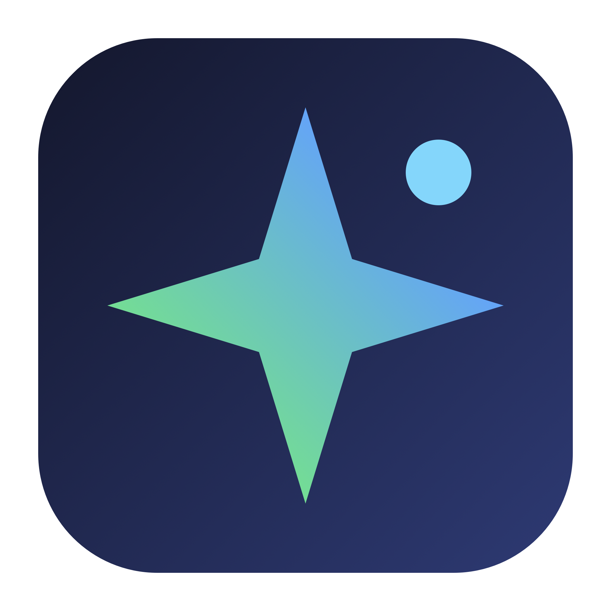
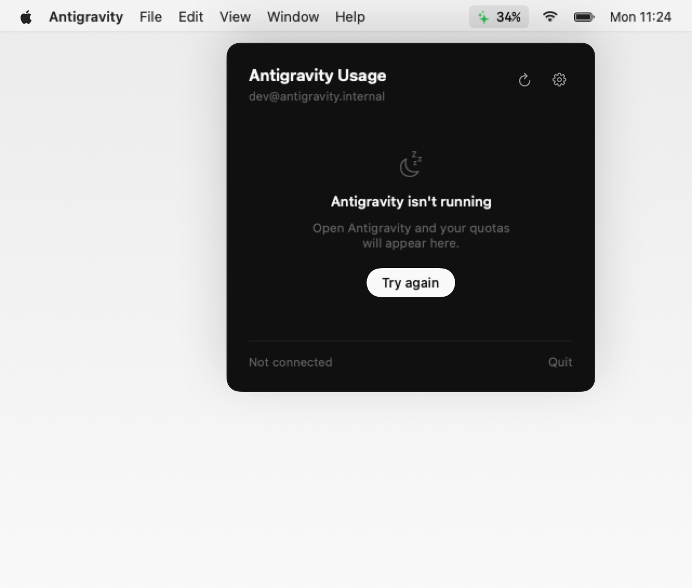
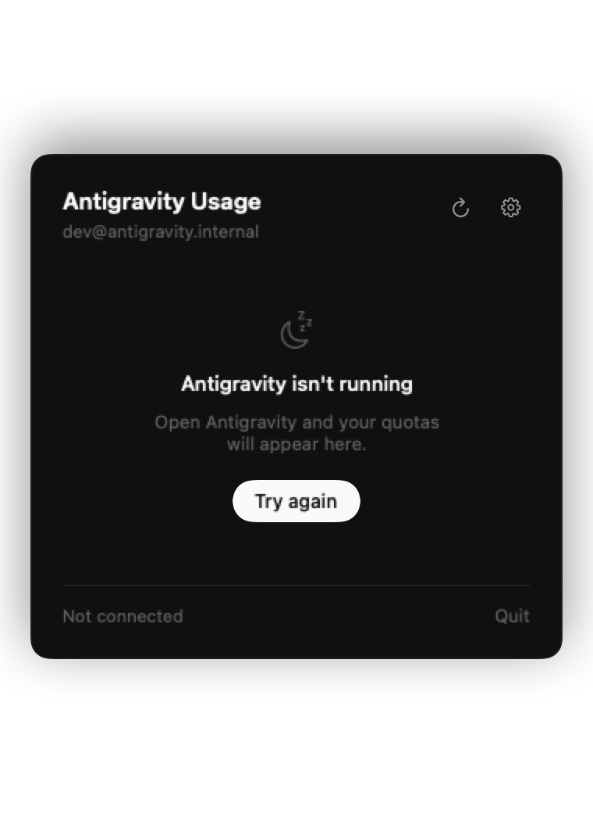
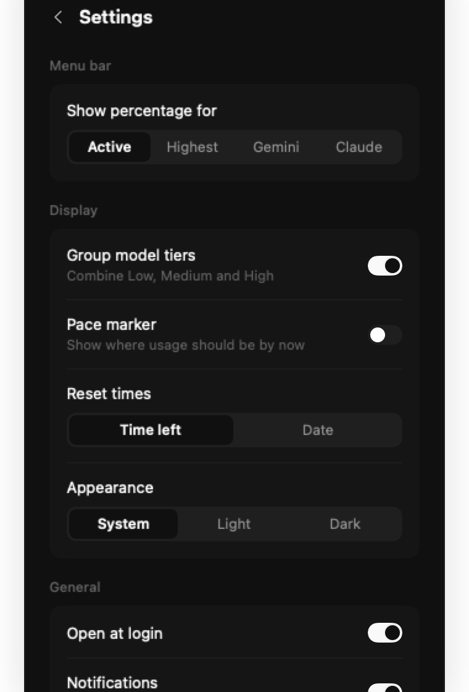
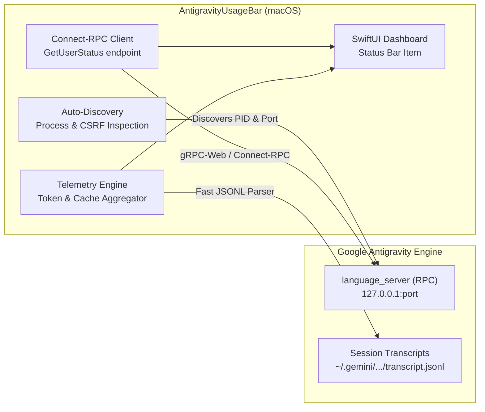

# AntigravityUsageBar

<p align="center">
  
</p>

<p align="center">
  <strong>Native macOS menu bar monitor for Google Antigravity model quotas, reset countdowns, and token telemetry.</strong>
</p>

<p align="center">
  <a href="https://opensource.org/licenses/MIT"></a>
  <a href="https://www.apple.com/macos/"></a>
  <a href="https://swift.org"></a>
  
  <a href="https://github.com/Kritternai/AntigravityUsageBar/releases/latest"></a>
  <a href="https://kritternai.github.io/AntigravityUsageBar/"></a>
</p>

<p align="center">
  <a href="https://github.com/Kritternai/AntigravityUsageBar/releases/latest"><strong>Download DMG</strong></a> &bull;
  <a href="https://kritternai.github.io/AntigravityUsageBar/"><strong>Interactive Web Demo</strong></a> &bull;
  <a href="#-key-features"><strong>Features</strong></a> &bull;
  <a href="#-architecture"><strong>How It Works</strong></a> &bull;
  <a href="#-acknowledgments--inspiration"><strong>Inspiration</strong></a>
</p>

---

<p align="center">
  
</p>

---

## ⚡ Why AntigravityUsageBar?

When pair-programming with **Google Antigravity**, running out of model quota unexpectedly breaks your flow. 

**AntigravityUsageBar** lives quietly in your macOS menu bar, giving you:
- **Instant visibility**: Glance up at any time to see quota percentage (`✦ 34%`).
- **Zero setup**: Automatically connects to Antigravity's local `language_server` on loopback (`127.0.0.1`). No browser cookies, no session tokens to extract, and no API keys required.
- **Pace indicators**: Know whether you're burning quota faster than the 5-hour replenishment rate.
- **Local token analytics**: Summarizes total prompt, output, and cache-read tokens directly from your session transcript logs.

---

## 📸 Screenshots

<p align="center">
  
  &nbsp;&nbsp;
  
</p>

<p align="center">
  
</p>

---

## ✨ Key Features

| Feature | Description |
|---|---|
| **Zero-Config Auto-Discovery** | Scans the local process table for Antigravity's `language_server`, extracting its dynamic port and CSRF token automatically. |
| **Real-Time Quota Tracking** | Live quotas for Gemini 2.5 Pro, Gemini 2.5 Flash, Claude 3.7 Sonnet, and custom models with remaining percentages and countdown timers. |
| **Pace Marker** | Visual tick mark on progress bars indicating safe usage pace across the 5-hour reset window. |
| **Local Token Telemetry** | Aggregates `~/.gemini/antigravity/brain/*` session transcripts to report today's and lifetime token volume + cache efficiency. |
| **Smart Status Bar Mark** | Minimalist four-point star icon reflecting quota health: **Green** (<70%), **Amber** (70–90%), or **Red** (>90%). |
| **Global Hotkey (`⌘⇧U`)** | Toggle the dashboard instantly from any active application with `Cmd+Shift+U`. |
| **Native macOS Design** | Clean, distraction-free neutral aesthetic with subtle capsules, smooth animations, and automatic Light / Dark mode. |
| **100% Private & Local** | All requests communicate solely with `127.0.0.1` and local JSONL logs. Zero external servers or tracking. |

---

## 🚀 Installation

### Option 1: Direct Download (Recommended)

1. Download **[`AntigravityUsageBar-Installer.dmg`](https://github.com/Kritternai/AntigravityUsageBar/releases/latest)**.
2. Double-click the DMG and drag **AntigravityUsageBar** into your **Applications** folder.
3. Open **AntigravityUsageBar** from Applications or Spotlight.
4. *(Optional)* If macOS Gatekeeper displays an unsigned developer alert:
   - Right-click the app in Finder &rarr; select **Open** &rarr; click **Open**.
   - Or run in Terminal:
     ```bash
     xattr -cr /Applications/AntigravityUsageBar.app
     ```

### Option 2: Build From Source

Requires macOS 12+ and Xcode Command Line Tools:

```bash
# Clone the repository
git clone https://github.com/Kritternai/AntigravityUsageBar.git
cd AntigravityUsageBar/app

# Build universal binary (arm64 + x86_64)
./build.sh

# Or generate a fresh DMG
./create_dmg.sh
```

---

## 🏗️ Architecture

Unlike typical menu bar extensions that scrape web cookies or mock browser requests, **AntigravityUsageBar** connects directly to the local backend infrastructure created by Google Antigravity on your machine:



### Architectural Comparison

| Dimension | Browser Cookie Scrapers | AntigravityUsageBar |
|---|---|---|
| **Authentication** | Manual cookie extraction from browser DevTools | **Zero config**: Extracts local CSRF token directly from process |
| **Session Lifetime** | Expires every few days or after browser logout | **Permanent**: Persists automatically whenever Antigravity runs |
| **Network Footprint** | External calls to cloud web endpoints | **100% Localhost**: Sub-millisecond loopback RPC queries |
| **Telemetry** | Cloud-reported high-level metrics only | **Deep local data**: Session count, steps, prompt/output/cache tokens |
| **Security Risk** | High: Stores sensitive cloud auth cookies | **Zero**: No credentials leaves your local machine |

---

## ⚙️ Configuration & Customization

Click the **gear icon** in the top-right corner of the popover to access settings:

- **Menu Bar Metric**: Choose whether the menu bar shows the active model, the highest quota, Gemini specifically, or Claude.
- **Appearance**: Follow system default, or force Dark / Light mode.
- **Reset Time Format**: Choose between human-readable countdowns (`Resets in 2h 15m`) or exact timestamps (`Resets at 4:30 PM`).
- **Pace Markers**: Toggle the safe-pace tick line on model progress bars.
- **Family Grouping**: Group models by family or list all granular variants individually.
- **Threshold Alerts**: Receive desktop banner notifications when any model hits 70%, 90%, or 95%.
- **Manual Port Override**: Optional manual port & CSRF override for custom headless server configurations.

---

## ⌨️ Shortcuts & Permissions

- **`⌘⇧U` (`Cmd+Shift+U`)**: Global shortcut to toggle the popover.
- *Accessibility Permission*: Required by macOS to register global keyboard shortcuts (`System Settings &rarr; Privacy & Security &rarr; Accessibility`). The app works completely without this permission if you prefer to click the menu bar icon.

---

## 🤝 Contributing

We welcome community feedback, pull requests, and ideas!

1. Fork the repository.
2. Create your feature branch (`git checkout -b feature/cool-feature`).
3. Commit your changes (`git commit -m 'feat: add cool feature'`).
4. Push to your branch (`git push origin feature/cool-feature`).
5. Open a Pull Request.

---

## 🙏 Acknowledgments & Inspiration

- **[Artzainnn/ClaudeUsageBar](https://github.com/Artzainnn/ClaudeUsageBar)**: This project was directly inspired by Artzainnn's elegant Claude menu bar monitor. While `ClaudeUsageBar` tracks Anthropic web session cookies, `AntigravityUsageBar` is re-architected from the ground up to interface natively with Google Antigravity's local language server and telemetry format.
- **Google Antigravity Team**: For building the cutting-edge agentic pair-programming environment.

---

## 📄 License

Distributed under the **MIT License**. See [`LICENSE`](LICENSE) for full details.
